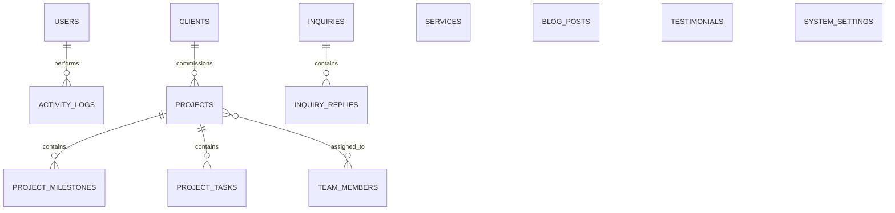
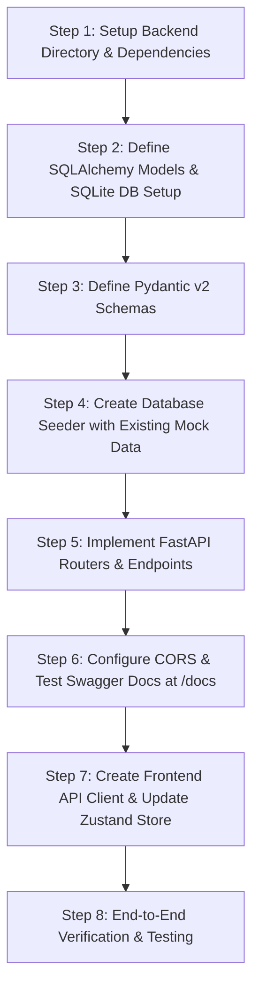

# Pixel Admin Panel &bull; Python Backend & SQLite Integration Plan

> **Author**: Antigravity AI Engine  
> **Target Architecture**: FastAPI (Python) + SQLite + SQLAlchemy 2.0 + Pydantic v2 & Next.js 16 (App Router)  
> **Status**: Architecture & Implementation Plan  
> **Date**: October 2026  

---

## 1. Executive Summary & Project Analysis

### 1.1 Existing Frontend Overview
**Pixel** is an enterprise-grade admin dashboard built with:
- **Framework**: Next.js 16.4 (App Router, Turbopack, React 19)
- **Styling**: Tailwind CSS v4, Lucide Icons, Radix UI primitives, Sonner toasts
- **State Management**: Zustand store (`lib/store.ts`) with `persist` middleware (currently saving state to browser `localStorage` initialized with rich mock datasets in `data/`)
- **Key Modules**:
  1. `Dashboard` (`/dashboard`): Real-time financial trajectory, project distribution donut chart, traffic velocity, activity feed.
  2. `Projects` (`/projects`, `/projects/[id]`): Full CRUD, milestone checklist, task assignments, budget burn tracker.
  3. `Clients` (`/clients`): Enterprise account cards, lifetime spend, status toggles.
  4. `Team` (`/team`): Engineering directory, department filters, skills badges.
  5. `Services` (`/services`): Capability catalog, pricing, public visibility toggles.
  6. `Blog` (`/blog`, `/blog/new`, `/blog/[id]`): Article management with split-screen markdown editor.
  7. `Inquiries` (`/inquiries`): Inbound RFP submissions, status pipeline, threaded reply box.
  8. `Testimonials` (`/testimonials`): Client ratings, 1-click approve/reject moderation.
  9. `Analytics` (`/analytics`): Visitor telemetry, acquisition channels, device breakdown.
  10. `Settings` (`/settings`): Profile, company metadata, SEO configurations, appearance preferences.
  11. `Authentication` (`/login`): Form validation via Zod, session cookies protected by Next.js edge `middleware.ts`.

### 1.2 Objective
Transition the application from browser `localStorage` mock data to a robust **Python REST API** backed by a local **SQLite** database (`pixel.db`), maintaining clean reactivity, high performance, and minimal disruption to the frontend UI components.

---

## 2. Technology Stack Selection

| Component | Choice | Rationale |
| :--- | :--- | :--- |
| **Language** | Python 3.10+ (Current runtime: 3.14) | High developer velocity, clean syntax, enterprise stability |
| **API Framework** | **FastAPI** | High throughput (ASGI / Starlette), native asynchronous support, auto-generated OpenAPI / Swagger docs at `/docs` |
| **Database** | **SQLite** (`pixel.db`) | Zero configuration, self-contained serverless file, ideal for local development, reproducible and easily backed up |
| **ORM & Query Builder** | **SQLAlchemy 2.0** | Modern declarative ORM, type-safe queries, seamless migration path to PostgreSQL/MySQL in the future without changing business logic |
| **Data Validation** | **Pydantic v2** | 1-to-1 parity with TypeScript types in `types/index.ts`, blazing fast Rust-based validation |
| **Authentication** | **JWT (python-jose / PyJWT) + Passlib / bcrypt** | Stateless bearer token authentication compatible with Next.js edge middleware and client headers |
| **ASGI Web Server** | **Uvicorn** | Fast, production-grade ASGI web server with auto-reload |
| **CORS Middleware** | `fastapi.middleware.cors` | Cross-Origin requests enabled for Next.js (`http://localhost:3000`) |

---

## 3. SQLite Database Schema & Entity Relationships

The SQLite database will model all 10 modules currently defined in `types/index.ts`:



### 3.1 Table Definitions

#### 1. `users` (Authentication & Admin Profiles)
- `id` (VARCHAR PK, UUID)
- `email` (VARCHAR UNIQUE, indexed)
- `hashed_password` (VARCHAR)
- `name` (VARCHAR)
- `avatar` (VARCHAR)
- `role` (VARCHAR, default: "Super Admin")
- `bio` (TEXT)
- `timezone` (VARCHAR, default: "UTC+5:30")
- `created_at`, `updated_at` (DATETIME)

#### 2. `clients`
- `id` (VARCHAR PK, UUID)
- `company` (VARCHAR NOT NULL)
- `contact_name` (VARCHAR NOT NULL)
- `email` (VARCHAR NOT NULL)
- `phone` (VARCHAR)
- `industry` (VARCHAR)
- `total_spend` (FLOAT, default 0.0)
- `active_projects` (INTEGER, default 0)
- `status` (VARCHAR: 'Active' | 'Inactive' | 'Lead')
- `website` (VARCHAR)
- `location` (VARCHAR)
- `logo` (VARCHAR)
- `notes` (TEXT)
- `created_at` (DATETIME)

#### 3. `team_members`
- `id` (VARCHAR PK, UUID)
- `name` (VARCHAR NOT NULL)
- `role` (VARCHAR NOT NULL)
- `department` (VARCHAR: 'Engineering' | 'Design' | 'Product' | 'Cloud & DevOps' | 'AI & Research')
- `skills` (JSON / TEXT: serialized list of tags)
- `email` (VARCHAR UNIQUE NOT NULL)
- `phone` (VARCHAR)
- `avatar` (VARCHAR)
- `status` (VARCHAR: 'Active' | 'Away' | 'Offline')
- `join_date` (VARCHAR / DATE)
- `bio` (TEXT)
- `location` (VARCHAR)

#### 4. `projects`
- `id` (VARCHAR PK, UUID)
- `code` (VARCHAR UNIQUE NOT NULL, e.g., 'PX-101')
- `name` (VARCHAR NOT NULL)
- `client_id` (VARCHAR FK -> clients.id, nullable)
- `client_name` (VARCHAR NOT NULL)
- `status` (VARCHAR: 'Planning' | 'In Progress' | 'Review' | 'Completed')
- `category` (VARCHAR: 'Web Development' | 'Mobile Apps' | 'UI/UX Design' | 'Cloud Architecture' | 'AI Solutions')
- `budget` (FLOAT NOT NULL)
- `spent` (FLOAT DEFAULT 0.0)
- `start_date` (DATE / VARCHAR)
- `deadline` (DATE / VARCHAR NOT NULL)
- `progress` (INTEGER DEFAULT 0)
- `description` (TEXT)
- `team` (JSON: array of `{id, name, avatar, role}`)
- `milestones` (JSON or relational table `project_milestones`)
- `tasks` (JSON or relational table `project_tasks`)
- `created_at`, `updated_at` (DATETIME)

#### 5. `services`
- `id` (VARCHAR PK, UUID)
- `title` (VARCHAR NOT NULL)
- `category` (VARCHAR NOT NULL)
- `description` (TEXT NOT NULL)
- `icon_name` (VARCHAR NOT NULL)
- `starting_price` (FLOAT NOT NULL)
- `features` (JSON: list of strings)
- `is_visible` (BOOLEAN DEFAULT TRUE)
- `delivery_time` (VARCHAR)
- `active_projects_count` (INTEGER DEFAULT 0)

#### 6. `blog_posts`
- `id` (VARCHAR PK, UUID)
- `title` (VARCHAR NOT NULL)
- `slug` (VARCHAR UNIQUE NOT NULL)
- `excerpt` (TEXT NOT NULL)
- `content` (TEXT NOT NULL)
- `cover_image` (VARCHAR)
- `author_name` (VARCHAR)
- `author_avatar` (VARCHAR)
- `author_role` (VARCHAR)
- `category` (VARCHAR)
- `tags` (JSON: list of tags)
- `status` (VARCHAR: 'Draft' | 'Published' | 'Scheduled')
- `views` (INTEGER DEFAULT 0)
- `reading_time` (VARCHAR)
- `published_at` (VARCHAR / DATETIME)

#### 7. `inquiries` & `inquiry_replies`
- `inquiries`:
  - `id` (VARCHAR PK, UUID)
  - `name` (VARCHAR NOT NULL)
  - `email` (VARCHAR NOT NULL)
  - `company` (VARCHAR)
  - `service` (VARCHAR)
  - `budget` (VARCHAR)
  - `message` (TEXT NOT NULL)
  - `date` (VARCHAR / DATETIME)
  - `status` (VARCHAR: 'New' | 'In Progress' | 'Resolved' | 'Spam')
- `inquiry_replies`:
  - `id` (VARCHAR PK, UUID)
  - `inquiry_id` (VARCHAR FK -> inquiries.id ON DELETE CASCADE)
  - `sender` (VARCHAR NOT NULL)
  - `message` (TEXT NOT NULL)
  - `timestamp` (DATETIME NOT NULL)

#### 8. `testimonials`
- `id` (VARCHAR PK, UUID)
- `client_name` (VARCHAR NOT NULL)
- `client_role` (VARCHAR NOT NULL)
- `company` (VARCHAR NOT NULL)
- `avatar` (VARCHAR)
- `rating` (INTEGER DEFAULT 5)
- `quote` (TEXT NOT NULL)
- `project` (VARCHAR)
- `status` (VARCHAR: 'Pending' | 'Approved' | 'Rejected')
- `date` (VARCHAR)

#### 9. `activity_logs`
- `id` (VARCHAR PK, UUID)
- `user` (VARCHAR NOT NULL)
- `avatar` (VARCHAR)
- `action` (VARCHAR NOT NULL)
- `target` (VARCHAR NOT NULL)
- `time` (VARCHAR NOT NULL)
- `type` (VARCHAR: 'project' | 'client' | 'blog' | 'inquiry' | 'testimonial' | 'team')

#### 10. `system_settings`
- `id` (VARCHAR PK, e.g. "default")
- `profile_json` (JSON)
- `company_json` (JSON)
- `seo_json` (JSON)
- `notifications_json` (JSON)
- `appearance_json` (JSON)

---

## 4. REST API Endpoint Specification

All endpoints will be prefixed with `/api/v1`.

### 4.1 Authentication (`/api/v1/auth`)
- `POST /api/v1/auth/login` &mdash; Validates credentials, returns JWT `access_token` and user profile.
- `GET /api/v1/auth/me` &mdash; Returns current authenticated user profile.
- `POST /api/v1/auth/logout` &mdash; Invalidates session.

### 4.2 Dashboard & Overview (`/api/v1/dashboard`)
- `GET /api/v1/dashboard/stats` &mdash; Returns live aggregated metrics (Total Revenue, Active Projects, Total Clients, Open Inquiries, Monthly Trajectory data).
- `GET /api/v1/dashboard/activities` &mdash; Recent audit events log.

### 4.3 Projects (`/api/v1/projects`)
- `GET /api/v1/projects` &mdash; List with search, category/status filters, pagination, sorting.
- `GET /api/v1/projects/{id}` &mdash; Detailed single project data with milestones and task list.
- `POST /api/v1/projects` &mdash; Create project (validates unique project code).
- `PUT /api/v1/projects/{id}` &mdash; Full or partial project update.
- `DELETE /api/v1/projects/{id}` &mdash; Remove project.
- `PATCH /api/v1/projects/{id}/milestones/{milestone_id}` &mdash; Toggle milestone completion.

### 4.4 Clients (`/api/v1/clients`)
- `GET /api/v1/clients` &mdash; List all client accounts.
- `POST /api/v1/clients` &mdash; Register new client.
- `PUT /api/v1/clients/{id}` &mdash; Update client details.
- `DELETE /api/v1/clients/{id}` &mdash; Delete client.

### 4.5 Team (`/api/v1/team`)
- `GET /api/v1/team` &mdash; List team members (filterable by department).
- `POST /api/v1/team` &mdash; Add new talent profile.
- `PUT /api/v1/team/{id}` &mdash; Edit member info & active status.
- `DELETE /api/v1/team/{id}` &mdash; Remove member.

### 4.6 Services (`/api/v1/services`)
- `GET /api/v1/services` &mdash; List all service offerings.
- `POST /api/v1/services` &mdash; Create service card.
- `PUT /api/v1/services/{id}` &mdash; Edit service specs.
- `PATCH /api/v1/services/{id}/visibility` &mdash; Toggle public web visibility.
- `DELETE /api/v1/services/{id}` &mdash; Remove service.

### 4.7 Blog Publications (`/api/v1/blog`)
- `GET /api/v1/blog` &mdash; Articles list with search and status filters.
- `GET /api/v1/blog/{id_or_slug}` &mdash; Retrieve article content for markdown editor.
- `POST /api/v1/blog` &mdash; Create article.
- `PUT /api/v1/blog/{id}` &mdash; Update article.
- `DELETE /api/v1/blog/{id}` &mdash; Delete article.

### 4.8 Inquiries & Lead Management (`/api/v1/inquiries`)
- `GET /api/v1/inquiries` &mdash; List inbound inquiries with status filters.
- `PATCH /api/v1/inquiries/{id}/status` &mdash; Update status (`New` -> `In Progress` -> `Resolved` / `Spam`).
- `POST /api/v1/inquiries/{id}/replies` &mdash; Add threaded reply message.
- `DELETE /api/v1/inquiries/{id}` &mdash; Delete inquiry record.

### 4.9 Testimonials (`/api/v1/testimonials`)
- `GET /api/v1/testimonials` &mdash; List client testimonials.
- `POST /api/v1/testimonials` &mdash; Submit testimonial.
- `PATCH /api/v1/testimonials/{id}/status` &mdash; 1-click Approve or Reject.
- `DELETE /api/v1/testimonials/{id}` &mdash; Delete testimonial.

### 4.10 System Settings & Reset (`/api/v1/settings`)
- `GET /api/v1/settings` &mdash; Retrieve global studio configuration.
- `PUT /api/v1/settings` &mdash; Update settings sections.
- `POST /api/v1/settings/reset-mock` &mdash; Re-seeds SQLite database from original initial mock data.

---

## 5. Backend File & Directory Structure

We will place the backend directly in a clean `backend/` directory within this workspace:

```
d:\projects\pixel\
├── backend/
│   ├── app/
│   │   ├── __init__.py
│   │   ├── main.py                # FastAPI entry point, CORS, lifespan handler
│   │   ├── core/
│   │   │   ├── __init__.py
│   │   │   ├── config.py          # Settings, SQLite path, JWT secret
│   │   │   ├── database.py        # SQLAlchemy engine, sessionmaker, Base
│   │   │   └── security.py        # Password hashing & JWT token handling
│   │   ├── models/                # SQLAlchemy ORM models
│   │   │   ├── __init__.py
│   │   │   ├── user.py
│   │   │   ├── project.py
│   │   │   ├── client.py
│   │   │   ├── team.py
│   │   │   ├── service.py
│   │   │   ├── blog.py
│   │   │   ├── inquiry.py
│   │   │   ├── testimonial.py
│   │   │   ├── activity.py
│   │   │   └── settings.py
│   │   ├── schemas/               # Pydantic models (matching TypeScript types)
│   │   │   ├── __init__.py
│   │   │   ├── project.py
│   │   │   ├── client.py
│   │   │   ├── team.py
│   │   │   ├── service.py
│   │   │   ├── blog.py
│   │   │   ├── inquiry.py
│   │   │   ├── testimonial.py
│   │   │   └── settings.py
│   │   ├── crud/                  # Reusable database queries & mutations
│   │   └── api/
│   │       ├── __init__.py
│   │       └── v1/
│   │           ├── __init__.py
│   │           ├── auth.py
│   │           ├── dashboard.py
│   │           ├── projects.py
│   │           ├── clients.py
│   │           ├── team.py
│   │           ├── services.py
│   │           ├── blog.py
│   │           ├── inquiries.py
│   │           ├── testimonials.py
│   │           └── settings.py
│   ├── data/
│   │   └── pixel.db               # SQLite database file (created on init)
│   ├── seed.py                    # Script to auto-populate DB with existing mock data
│   ├── run.py                     # Convenience startup script (python run.py)
│   ├── requirements.txt           # Python dependencies
│   └── README.md                  # Backend setup & documentation
├── app/                           # Next.js 16 frontend
├── components/
├── lib/
│   ├── api.ts                     # API client wrapper (fetch with base URL & auth)
│   └── store.ts                   # Zustand store (updated to sync with Python API)
└── package.json
```

---

## 6. Frontend Integration Architecture

To ensure minimum code changes and maximum stability:

### 6.1 Unified API Client (`lib/api.ts`)
We create a strongly-typed `api` module that wraps standard `fetch`:
```typescript
const API_URL = process.env.NEXT_PUBLIC_API_URL || "http://localhost:8000/api/v1";

export async function apiClient<T>(endpoint: string, options?: RequestInit): Promise<T> {
  const token = typeof window !== "undefined" ? localStorage.getItem("pixel_token") : null;
  const headers = {
    "Content-Type": "application/json",
    ...(token ? { Authorization: `Bearer ${token}` } : {}),
    ...options?.headers,
  };

  const response = await fetch(`${API_URL}${endpoint}`, { ...options, headers });
  if (!response.ok) {
    const error = await response.json().catch(() => ({ message: "Request failed" }));
    throw new Error(error.detail || error.message || "An unexpected error occurred");
  }
  return response.json();
}
```

### 6.2 Hybrid Zustand Store (`lib/store.ts`)
The current components in `app/projects/page.tsx`, `app/clients/page.tsx`, etc., call store actions such as:
- `addProject(data)`
- `updateProject(id, data)`
- `deleteProject(id)`
- `useAdminStore((state) => state.projects)`

**Seamless Transition Strategy**:
We can upgrade `lib/store.ts` actions to be `async` and trigger the API endpoints behind the scenes while updating local state optimistically or re-syncing from API:
1. `fetchInitialData()`: Called on app load or layout mount to populate store state from SQLite.
2. `addProject`: Calls `POST /api/v1/projects`, then adds the returned entity to the Zustand store.
3. `updateProject`: Calls `PUT /api/v1/projects/{id}`, then updates state.
4. `deleteProject`: Calls `DELETE /api/v1/projects/{id}`, then filters state.

This guarantees that **zero page JSX components need to be rewritten**! All buttons, dialogs, filters, forms, and sorting logic continue to work identically.

---

## 7. Step-by-Step Implementation Roadmap



### Phase 1: Environment & FastAPI Foundation
1. Create `backend/requirements.txt` with:
   - `fastapi>=0.115.0`
   - `uvicorn[standard]>=0.32.0`
   - `sqlalchemy>=2.0.36`
   - `pydantic>=2.10.0`
   - `python-jose[cryptography]>=3.3.0`
   - `passlib[bcrypt]>=1.7.4`
   - `python-multipart>=0.0.17`
2. Set up virtual environment and install dependencies.
3. Configure `backend/app/core/config.py` for SQLite database URL (`sqlite:///./data/pixel.db`).

### Phase 2: Database Models & SQLAlchemy 2.0
1. Create models inheriting from `Base` with appropriate types and indexes.
2. Ensure JSON columns handle nested structures (such as project milestones, tasks, team tags, and replies).

### Phase 3: Pydantic Schemas & Data Seeder
1. Write Pydantic request and response schemas matching existing TypeScript types.
2. Write `seed.py` that reads the default records from `data/mock*.ts` (converted to JSON or Python dicts) and inserts them into SQLite. This ensures the app opens with rich, realistic data immediately.

### Phase 4: RESTful API Endpoints Implementation
1. Implement routers for `auth`, `dashboard`, `projects`, `clients`, `team`, `services`, `blog`, `inquiries`, `testimonials`, and `settings`.
2. Add CORS middleware allowing `http://localhost:3000`.
3. Verify interactive Swagger UI at `http://localhost:8000/docs`.

### Phase 5: Next.js Integration
1. Add `.env.local` with `NEXT_PUBLIC_API_URL=http://localhost:8000/api/v1`.
2. Create `lib/api.ts` with API service functions for each entity.
3. Connect `lib/store.ts` actions to call backend APIs.
4. Add an initialization hook in `components/shared/AdminLayout.tsx` or `app/layout.tsx` to hydrate data from the backend on initial page load.

### Phase 6: Verification & Handover
1. Start FastAPI server (`python backend/run.py`).
2. Run Next.js (`npm run dev`).
3. Test CRUD operations (Create a project, edit a client, reply to an inquiry, toggle service visibility, change settings).
4. Verify changes are persistently saved in SQLite database `pixel.db`.

---

## 8. Summary of Deliverables

- **`backend/` folder**: Production-ready, modular FastAPI application.
- **`backend/data/pixel.db`**: Local SQLite database with all tables pre-configured.
- **`backend/seed.py`**: Automated seeding script with 20+ realistic mock records per module.
- **`lib/api.ts`**: Clean, type-safe API client for Next.js.
- **Updated `lib/store.ts`**: Connected to SQLite backend with optimistic updates and cache management.
